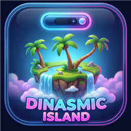

<div align="center">
  
  <h1>Dynamic Island for Windows 10 / 11</h1>
  <p><b>Нативный 60 FPS оверлей на C# (.NET Framework 4.8 + Win32 Layered DIB + DWM) без внешних зависимостей</b></p>
</div>

---

## ✨ Основные возможности

- **Мульти-плеер и эквалайзер (Страница 1)**: поддержка Яндекс Музыки, Spotify, AIMP, VLC и любых браузеров через WinRT SMTC, синхронизация лайков (`♥`), раздельная регулировка громкости (`Звук ПК` и `Музыка`), таймер фокусировки (Помодоро) со встроенными и своими мелодиями, быстрый док приложений (`[ + ]`) и файловая полка Dropzone.
- **Аппаратная трансляция экранов и видео (Страница 2)**: 60/144 FPS DWM-просмотр демонстраций экрана Discord, YouTube, Twitch и любых окон поверх рабочих программ и полноэкранных игр (работает даже при свёрнутом окне Discord).
- **Хранилище скриншотов и Стоп-таймер загрузок (Страница 3)**: мгновенный перехват `Win + Shift + S` / `PrtScn` с перетаскиванием прямо в чаты, а также автоматический переход ПК в Сон / Гибернацию / Выключение после завершения крупных закачек.
- **Умный игровой режим и Режим «Призрака»**: авто-определение полноэкранных D3D-игр с переключением в ультракомпактную полоску неоновой телеметрии (`CPU • GPU • Temp • Ping`) или авто-скрытие, плюс прозрачный click-through режим «Призрака» и индикатор/мьют микрофона в один клик.

---

## 🚀 Быстрая установка и запуск

### Вариант 1 — Готовый установщик (рекомендуется)
1. Скачайте **`DynamicIslandWin_Setup.exe`** (или `DinamicIsland-Setup.exe`) из раздела **Releases** (или из папки `dynamic_island/release/`).
2. Запустите установщик и нажмите **«Установить Dynamic Island»** — приложение распакуется в `%LOCALAPPDATA%\Programs\DynamicIslandWin`, создаст ярлыки и сразу запустится.

### Вариант 2 — Сборка из исходников (встроенным компилятором Windows)
Никаких сторонних SDK устанавливать не нужно — используется штатный `csc.exe` из Windows 10/11:
```powershell
$csc = "C:\Windows\Microsoft.NET\Framework64\v4.0.30319\csc.exe"
$wpf = "C:\Windows\Microsoft.NET\Framework64\v4.0.30319\WPF"
$fw  = "C:\Windows\Microsoft.NET\Framework64\v4.0.30319"
$wm  = "C:\Windows\System32\WinMetadata"

& $csc /nologo /optimize+ /target:winexe /platform:x64 `
  /win32icon:"dynamic_island\DynamicIslandWin.ico" `
  /out:"dynamic_island\release\DynamicIslandWin.exe" `
  /r:System.dll /r:System.Core.dll /r:System.Drawing.dll /r:System.Windows.Forms.dll `
  /r:System.Web.Extensions.dll /r:System.Management.dll `
  /r:"$wpf\UIAutomationClient.dll" /r:"$wpf\UIAutomationTypes.dll" `
  /r:"$fw\System.Runtime.dll" /r:"$fw\System.Runtime.WindowsRuntime.dll" `
  /r:"$wm\Windows.Foundation.winmd" /r:"$wm\Windows.Media.winmd" /r:"$wm\Windows.Storage.winmd" `
  "dynamic_island\NativeDynamicIsland.cs"
```

---

## 📖 Краткая инструкция по управлению

| Действие | Как использовать |
| :--- | :--- |
| **Раскрыть / свернуть остров** | Наведите курсор на капсулу у верхнего края экрана (или кликните ЛКМ) |
| **Глобальная горячая клавиша** | **`Alt + Space`** — мгновенно раскрыть/свернуть остров или вывести из режима «Призрака» |
| **Переключение страниц (`1 ↔ 2 ↔ 3`)** | Нажмите на аккуратные стрелочки **`‹`** и **`›`** по левому и правому краям раскрытого острова |
| **Открыть настройки (`Studio Pro`)** | Нажмите **ПКМ** по острову или иконку шестерёнки **`⚙`** на 1-й странице (либо через иконку в трее) |
| **Свободное изменение размера на лету** | Зажмите **`Левый Ctrl` + ЛКМ** и тяните край острова; **`Левый Ctrl` + Колёсико** — масштаб текста; **`Левый Ctrl` + СКМ** — сброс к эталону |
| **Регулировка громкости** | Крутите **колёсико мыши** над островом для системной громкости или над плашкой **«Музыка»** для громкости плеера |
| **Смена активного плеера** | Кликните по бейджу плеера над названием трека (ЛКМ — следующий плеер, ПКМ — список всех плееров, СКМ — развернуть окно плеера) |
| **Просмотр стримов Discord / YouTube** | Перейдите на **Страницу 2 (`›`)**: верхняя левая кнопка меняет окно (ПКМ открывает список всех окон), средняя меняет кадрирование (`Стрим (Авто)` / `На весь остров` / `Окно целиком` / `Крупный план`) |
| **Скриншоты и полка файлов** | Сделайте скриншот (`Win + Shift + S`) — на **Странице 3** клик копирует его в буфер, а перетаскивание мышью отправляет файл прямо в Discord/Telegram/браузер |
| **Быстрый мьют микрофона** | Кликните по зелёному/красному индикатору микрофона в компактной капсуле или кнопке **«Микр»** на 1-й странице |
| **Точный ввод чисел в настройках** | В окне настроек кликните по числовому значению справа от любого ползунка, введите число с клавиатуры и нажмите `Enter` |

---

## 🗂 Где хранятся настройки

Конфигурация сохраняется автоматически в `%APPDATA%\DynamicIslandWin\config.json` и сохраняется при любых обновлениях приложения.